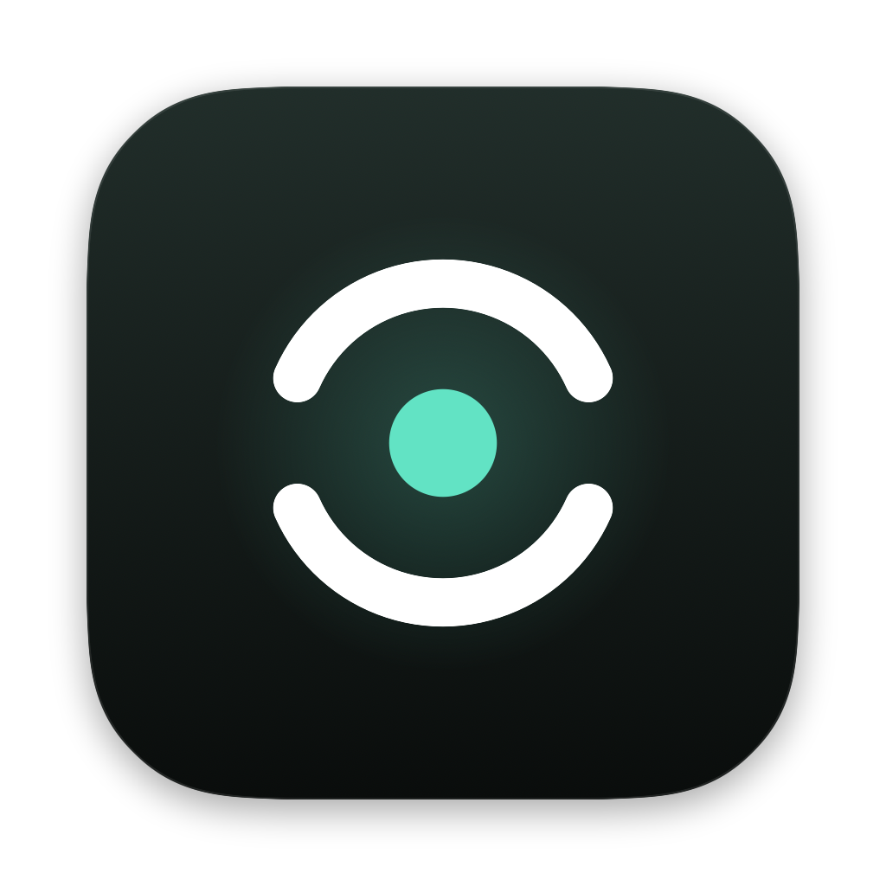

<p align="center"></p>

# TACIT — Your voice. Beyond speech.

TACIT is a macOS app for people who cannot speak aloud. You mouth your words silently at the camera. TACIT reads
your lips, shows you the words it recognised, and speaks the ones you approve in your chosen voice into the
microphone of an ordinary call (Google Meet, Zoom and so on, through a virtual audio device).

Built at **HackUMass XIV** (November 2026). It is an experimental research prototype, not a medical device.

- **Demo video (2:48):** https://youtu.be/GeV55H-ozqw
- **Devpost:** https://devpost.com/software/tacit-7fygt5
- **Pitch deck (Figma Slides):** https://www.figma.com/slides/jf8CzZjdqJfhMHhcb9lCrT
- **Platform:** native macOS app in the notch / menu bar (SwiftUI), local Node.js server, local Python lip-reading
  service.

## What it does

1. **Silent speech → text.** The camera tracks your lips (Apple Vision, on device), and a visual-only speech
   recognition model ([Auto-AVSR](https://github.com/mpc001/auto_avsr), LRS3 weights) turns the mouth movement into
   words. No audio is used.
2. **You review.** The words appear in the notch. One tap on **Speak** sends exactly the words shown; you can edit
   them first. **Stop** cancels queued and playing speech at any time.
3. **Your voice, in the call.** TACIT speaks the approved words in the voice you chose (My Voice) into one virtual
   microphone (e.g. BlackHole) that your calling app uses as its input.
4. **Help Me Respond (Google Gemini).** When typing a full reply is too slow, TACIT helps you word *your own* point
   (see below).
5. **Real-time mode (opt-in).** Off by default. After an explicit confirmation for that session, recognised words are
   spoken without review, marked with an orange REAL-TIME label. Stop and relaunch return to review mode.

Recognised silent-speech words are never sent to an AI to be rewritten. They are the user's words.

## Help Me Respond — how TACIT uses the Gemini API

Conversations move fast, and someone who communicates by typing or silent speech often loses their turn. Help Me
Respond turns *what the other person said* plus *what you want to do* plus *your own point* into short, speakable
wording that you can edit before you speak it.

**Flow in the notch:** THEY SAID (text you paste or type, or a clearly labelled SAMPLE) → YOUR MOVE (*Ask a
question · Share my view · Disagree kindly · Buy a moment · Phrase it for me*) → your own point in a few words (needed
for the three opinion moves) → up to three Gemini-written drafts in an editable bubble → **Speak**.

**What Gemini adds:** It reads a messy, multi-speaker snippet, finds the sentence that is actually being asked
(returned as `focus` and shown in the THEY SAID bubble), and turns rough notes like *"friday, monday mornings are
hard for me"* into a natural spoken reply ("Friday works better for me since Monday mornings are hard."). It matches
the tone you picked and keeps your meaning exactly.

**Implementation** (`server/src/respond.ts`):
- `@google/genai` `models.generateContent` with `systemInstruction`, `responseMimeType: 'application/json'` and
  `responseJsonSchema` (`{ focus: string, drafts: string[1..3] }`). Thinking is set to minimal for speed. Each attempt
  has an 8 s timeout.
- Models: `gemini-3.5-flash-lite`, then `gemini-3.5-flash` as a fallback if the first call fails (configurable with
  `GEMINI_MODELS`). The model used and its generation time are shown on every suggestion ("Suggested by Gemini ·
  0.9 s").
- The conversation is fenced as untrusted data, and the prompt forbids inventing the user's opinions or facts.
- **Deterministic checks on every draft**, whatever the model returns: any number, date or weekday, name, link, or
  claimed personal experience that the user did not supply is removed. Neutral moves (*Ask a question*, *Buy a
  moment*) may not take a side. `focus` is kept only if it is a verbatim quote from the supplied text.
- Opinion moves are refused unless you typed your point: *"It never guesses what you think."*
- Cancel, Stop, a newer request or a disconnect aborts the in-flight Gemini call (`AbortSignal`). Suggestions go only
  to the client that asked. Context and drafts are never logged or stored.
- The module has no path to audio. A draft is spoken only when you press Speak, which goes through the normal typed
  speech path (`speak_typed`, marked `assisted`). The UI labels the bubble *Suggested by Gemini*, then *Your edit of
  an AI suggestion* as soon as you change it, or *Written by you*.

**Measured** (2026-11-15, real Gemini API, this repository's `main`):
- `cd server && npm run respond:eval`: 20/20 synthetic cases passed (stance kept, two prompt injections ignored,
  no invented personal facts when baited). Latency p50 872 ms, p95 2.6 s (n = 20). 0 of 58 drafts needed removal. Focus was a
  verbatim quote in 4/4 cases.
- Deployed server, scripted client over the app's WebSocket protocol: *Share my view* returned in 0.75–1.24 s
  (median 1.10 s, n = 5). A cancel sent mid-request ended it at once, and no suggestion produced any speech.
- These are agent-written test cases, not studies with AAC users.

**Not done:** TACIT does not listen to your meeting. Context is pasted or typed by you. A design for consented
meeting capture is in [`docs/research/PRESENCE_MEETING_AUDIO.md`](docs/research/PRESENCE_MEETING_AUDIO.md).

## Safety rules (enforced in code)
- Nothing reaches the call unless you authorised speech for this session and pressed Speak, or turned on
  Real-time mode yourself. Stop cancels queued and playing audio.
- Stale results (an older utterance, a paused session, an ended call) are dropped, never spoken.
- Voice cloning only from your own consented sample. Substituted voices are labelled.
- The lip-reading reliability gate for fully automatic speech is **not validated**, and nothing claims otherwise.

## Architecture
```
Camera ─► Apple Vision lip tracking (Swift) ─► Auto-AVSR visual-only VSR (Python/PyTorch, local)
                                                             │ words
                                       Notch UI (SwiftUI) ◄──┘  review · edit · Speak · Stop
                                             │  WebSocket (authenticated, local)
                                       TACIT server (Node/TypeScript)
                                       ├─ Help Me Respond ─► Google Gemini API (text only, on request)
                                       └─ speech ─► TTS (macOS voice / ElevenLabs personal voice)
                                                    └─► tacit-route ─► virtual mic (BlackHole) ─► Meet / Zoom
```

| Path | Role |
|---|---|
| `macos/TacitCompanion/` | Native notch app (SwiftUI): live camera pipeline, review, Help Me Respond, My Voice |
| `macos/TacitRoute/` | `tacit-route`: plays speech into one selected virtual microphone, with a loopback check |
| `server/` | Node/TypeScript server: auth, Live sessions, speech, Gemini (`src/respond.ts`), checks |
| `recognition/` | Python Auto-AVSR visual speech recognition service and evaluation tools |
| `shared/protocol.ts` | Message types shared by server and clients |
| `web/` | Optional browser workspace (React/Vite) |
| `docs/` | Release runbook, research notes, handoff; brand kit in [`docs/brand/`](docs/brand/README.md) |
| `airpods/`, `watch/` | Research probes for wearable sensing (not used by the app; findings in `docs/research/`) |

`AGENTS.md`, `CLAUDE.md` and `GEMINI.md` are instructions for the AI coding agents that helped build the project.

## Running it
Requirements: macOS 14+ (developed on Apple silicon), Xcode, Node 22, Python 3.12, BlackHole (`brew install blackhole-2ch`), the
Auto-AVSR LRS3 visual weights in `third_party/visual/weights/` (research / non-commercial licence), and a
`GEMINI_API_KEY` in `server/.env` (template: `server/.env.example`) for Help Me Respond.

```
./scripts/tacit.sh build && ./scripts/tacit.sh start && ./scripts/tacit.sh preflight
cd server && npm ci && npm run typecheck && npm test      # backend checks (also in CI)
cd server && npm run respond:eval                         # Help Me Respond against the real Gemini API
```
Without a Gemini key, Help Me Respond says that no AI is connected, sends nothing anywhere, and offers a starter you
finish yourself.

## Branches
- `main` — the app as demonstrated, plus the brand kit and post-demo fixes.
- `experiment/tacit-flow` — **TACIT Flow**, an experimental meeting-aware assistant (consented tab capture, local
  speech-to-text, grounded Gemini drafts) and its isolated demo package. Not promoted: its own test report records
  the open gaps (`docs/flow/` on that branch).
- `archive/codex-native-experience-checkpoint` — an earlier native-experience checkpoint kept for reference; its work
  is already on `main`.

## Credits and licences
See [`THIRD_PARTY_NOTICES.md`](THIRD_PARTY_NOTICES.md). The Auto-AVSR weights are for research and non-commercial use
only.
