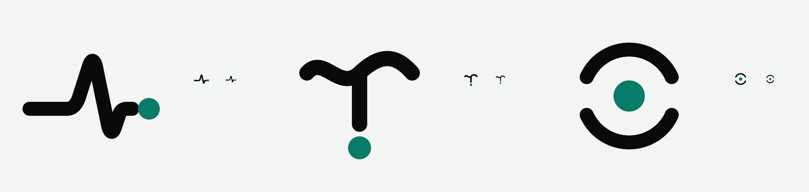

# TACIT brand — Living Signal

Mini brand guide, design decision record and asset index. All vector and raster assets here are **generated from one
geometric source**, `macos/TacitCompanion/Sources/TacitCompanion/Brand/TacitBrand.swift`, which also draws the mark in
the app. Regenerate with:

```sh
cd macos/TacitCompanion && DEVELOPER_DIR=/Applications/Xcode.app/Contents/Developer swift build
env -i HOME=$HOME PATH=/usr/bin:/bin .build/debug/TacitCompanion --export-brand /tmp/tacit-brand   # offline, ~10 s
iconutil -c icns /tmp/tacit-brand/png/AppIcon.iconset -o docs/brand/app-icon/TACIT.icns
```

## 1. Concepts explored (`concepts/`)



| | A — Silent Pulse | B — The Tacit T | **C — Living Signal (selected)** |
|---|---|---|---|
| Idea | Closed-lip line lifting into one pulse + activation dot | T whose crossbar is an articulation wave; stem ends in the voice dot | Two arcs (lips) around one dot (voice); gaps at the mouth corners |
| Distinctiveness | Reads as an ECG trace (medical) | Reads as a ram/Aries glyph or "Y" | Original; no mic, bubble or sparkle |
| 12–20 pt | Pulse collapses into a squiggle | Wave crossbar muddies at 14 pt | Holds at 14 pt: two strokes + dot |
| Mission link | Signal, not person | Name, not behaviour | Mouth → voice, the product in one glyph |
| Animation | One gesture only | Little to animate | Lips part, arcs rotate, voice leaves through the gap |
| Notch fit | Wide aspect, wastes a square slot | Tall, vertical stress | Square, centred, sits beside Pause/Stop |
| Icon / favicon | Weak in a square | OK | Strong (see app icon) |

**Decision:** C. It's the only one whose animation states mean something without explanation (lips part = TACIT sees
you mouthing; voice arcs leave = your words are being spoken). The trade-off: a ring with a dot is a common family of
shapes, so distinctiveness comes from the mouth-corner gaps, the lip motion and the wordmark echoes.

## 2. Identity system

| Asset | Files |
|---|---|
| Mark (dark / light / mono / high contrast) | `svg/tacit-mark*.svg`, `png/tacit-mark-{1024…16}.png`, `png/tacit-mark-on-light-1024.png`, `png/tacit-mark-high-contrast-1024.png` |
| Wordmark (custom monoline lowercase) | `svg/tacit-wordmark*.svg`, `png/tacit-wordmark*-2400.png` |
| Horizontal lockup | `svg/tacit-lockup*.svg`, `png/tacit-lockup*-3200.png` |
| App icon | `app-icon/tacit-app-icon-1024.png`, `app-icon/TACIT.icns` (bundled by `build-app.sh`) |
| Favicon | `svg/tacit-favicon.svg`, `png/tacit-favicon-{32,16}.png` |
| Living states (stills) | `png/states/*.png` |

**Geometry (24-unit grid):** centre (12,12) · lip radius 7.25 · stroke 2.2 · mouth-corner gap 2 × 24° · voice dot r 2.45 ·
round caps. Wordmark: x-height 12, stroke 2.8, open `c` (repeats the mouth gap), `i` dot = the voice dot (always the
accent colour). Lockup: wordmark at 0.9× with its x-height centred on the ring, 4 units gap. Clear space: one ring
radius on all sides. Minimum size: mark 12 pt (14 pt preferred), wordmark 9 pt tall.

**Palette** (contrast measured, WCAG relative luminance):

| Token | Hex | Use | Contrast |
|---|---|---|---|
| Ink | `#0A0D0C` | Backgrounds, notch | — |
| Graphite | `#16201D` | Raised dark / gradients | — |
| Paper | `#F4F7F6` | Light backgrounds | Ink on paper 18.1:1 |
| Mint | `#62E3C4` | Voice dot, active signal on dark | 12.4:1 on ink, 13.3:1 on black |
| Teal | `#0B7D6B` | Voice dot on light | 4.7:1 on paper, 5.05:1 on white |
| Amber | `#FFB547` | Real-time, paused, attention | 11.1:1 on ink |

Typography: the wordmark is custom vectors (no font licence needed). The in-app UI uses the system font. The title-card
tagline is set in the system font as a raster; for external print/web use, set the tagline in a licensed open font (e.g. Inter).

**Don'ts:** no gradients on the mark, no outline/stroke changes, no rotation at rest, never mint for real-time, warnings
or "heard" claims, never attach a microphone or waveform to the mark.

## 3. Signature behaviour — the Living Mark (implemented)

`Brand/LivingMark.swift`. Pure model (`LivingMark.frame`) + a SwiftUI `Canvas` renderer. Every mode comes from a state
the app already has; nothing is synthesised and nothing authorises or delays speech.

| Mode | Source of truth | Shape (colour-independent) | Motion |
|---|---|---|---|
| connecting | socket connecting | hollow core, dim lips | still |
| idle | ready | logo at rest (white lips, mint dot) | still |
| live | native camera running | lips slightly apart, mint | still |
| articulating | endpointer phase `.capturing` (real lip motion) | lips wide apart, larger dot | still pose, 0.32 s blend in/out |
| processing | recognition request in flight | lips rotating | 200°/s loop (Reduce Motion: turned 90°) |
| review | a current, unexpired review | bigger dot + halo ring | one 0.8 s contained pulse, then still |
| preparing | delivery queued / synthesizing / routing before first audio | one faint voice arc | still |
| speaking | server-reported first audio | voice arcs leave through the right-hand gap | 1.3 s loop; **state loop, not amplitude** (no envelope exists in the companion) |
| paused | Live or output paused | pause bars, dim lips, amber | still |
| attention | camera/voice/recogniser problems | "!" core, amber | still |

Real-time mode tints active states amber. Transitions blend over 0.32 s (ease-out cubic), are skipped under Reduce Motion,
and never gate input. VoiceOver: the mark is decorative; the status control carries the state, and four sparse
announcements are posted (`Words ready to review…`, `Speaking your words…`, `Paused…`, `TACIT needs attention…`).

**Performance (measured, offline lab, M-series, 8 s windows):** still states 0.0 % CPU. Processing loop 6.6 %,
speaking loop 8.5 % of one core, both short-lived and event-bounded. A continuous camera-on breathing loop cost 4.4–5 %
regardless of frame rate (`.animation` and `.periodic` schedules, `drawingGroup` and a nested hosting view were all
measured) and was **removed**: a camera session costs 0 % for the mark. Window resize pacing is unchanged vs the
pre-brand baseline (8.34 ms p50 / 16.8 ms p95 vs 8.34 / 15.96).

## 4. Complementary microinteraction — Voice Transfer (implemented)

`Brand/DeliveryTrack.swift`, shown at the top of the speaking Peek: **Voice → Call mic / Playing → Done**, driven only by
`speech_delivery` states (`queued|synthesizing` → `routing` → first audio → `rendered`; `interrupted` → Stopped;
`failed|refused` → Not sent). Each status has its own marker shape (check / ringed dot / hollow / square / cross).
Its accessibility label ends "Local output status only". It never claims a remote listener heard anything.

## 5. Placement in the notch

- Notched Mac: unchanged geometry (`cbb1612`): the band is the hardware cutout + two 66 pt wings. Left wing: wordmark
  (10.5 pt tall). **Right wing: Living Mark 17 pt + Pause/Stop.** Budget tested (`NotchLayout`, right wing 60 ≤ 66 pt).
- Non-notch: 264 × 38 pill: wordmark · status line · mark · Pause/Stop. The chevron appears on hover only.
- Discreet: 13 pt mark on the right.
- Expanded workspace inside the notch no longer repeats "tacit" (the crown already shows it).

Evidence (offline fixtures, never real capture/audio): `evidence/` sheets plus `motion/tacit-notch-states-offline.mp4`,
recorded from the app's own island view at real 33.7 ms median intervals.

## 6. Film assets (`motion/`, `png/`)

- `motion/tacit-logo-reveal-1080p.mp4` (4.5 s): lips draw outward from the centre (0–0.7 s), part as if forming a word
  (0.75–1.65 s), the voice dot arrives (1.0–1.35 s), two voice arcs leave through the gap (1.55–2.55 s), the mark slides
  into the lockup and the wordmark fades in (2.55–3.45 s), hold.
- `motion/tacit-speaking-loop-720.mp4` / `-240.gif`: the speaking state, seamless 1.3 s cycle.
- `png/tacit-title-card-{3840x2160,1920x1080}.jpg`: dark title lockup + tagline. `png/states/*.png`: stills of each state.
- These are brand motion graphics. Do not present them as app footage; real UI shots come from the running app.

## 7. Future ideas (NOT implemented)

1. **Lip-driven articulation:** publish a throttled (≤ 10 Hz) lip-velocity level from `NativeLivePipeline` and let the
   lip separation follow it. Real data, but it needs a Core Animation renderer first (see the CPU measurements).
2. **Review confidence:** halo thickness from decoder agreement between candidates (needs a calibrated, measured signal;
   no confidence claims until then).
3. **Expressive phrase motion:** each saved phrase gets a tiny signature (dot position) so it's recognisable at a glance.
4. **Voice identity visual:** the voice dot takes a per-voice hue ring when My Voice uses a cloned vs system voice, with
   the substitution label kept.
5. **Route awareness:** a small "mic" notch on the right gap when a calling app is reading the virtual mic (already known
   from route readers). Never implies the remote side heard anything.
