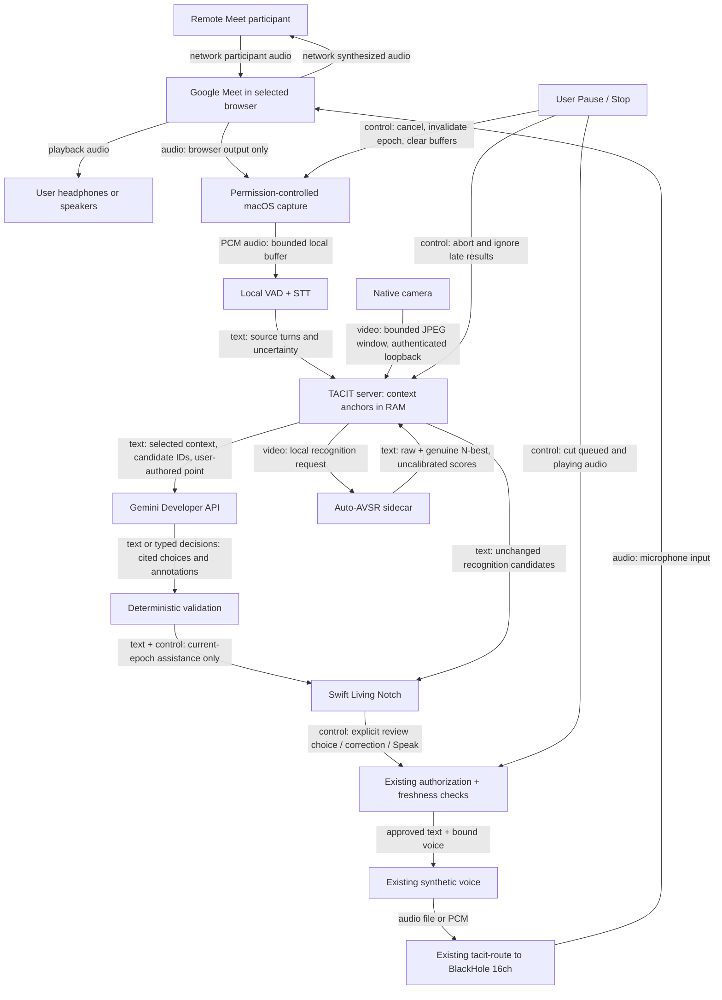

# TACIT × Gemini: deep integration exploration

Research date: 2026-11-15. Local inspection began at 11:21 UTC. Architecture proposal only; no implementation, deployment, API inference, recording upload, or runtime mutation was performed.

Requested repository destination: `docs/research/GEMINI_DEEP_INTEGRATION_EXPLORATION.md`. Delivered outside the working tree because canonical `AGENTS.md` assigns `docs/research/**` and `docs/HANDOFF.md` to Claude. This report does not transfer ownership. No repository file, including HANDOFF, was edited.

## 1. Executive summary

**Recommendation: make Gemini a private conversational interpretation and repair layer, with the user choosing meaning and TACIT retaining exclusive control of speech authorization.** The strongest experience is **Anchored Conversation + Repair**: consented Meet context → an exact question anchor → the user silently articulates or authors a short point → recognition differences or unresolved references become small, explicit choices → the user reviews the complete outgoing sentence → TACIT speaks it through its existing voice and BlackHole path.

The most valuable breakthrough is not more fluent guesses. It is reducing the amount of language the user must inspect, type, or repair to communicate their own intent.

Build this in stages. First prove a **text-only Referent Bridge** using a manually supplied conversation, user-selected references, and a user-authored point. Then test **Meaning Contrast**, which highlights consequential differences between genuine visual-decoder candidates without rewriting or silently selecting them. Add native meeting capture only after a separate consented audio-isolation proof. Candidate reranking is an experiment, not the centerpiece.

Three findings change the architecture:

1. **Google Meet Media API is a dead end for durable integration.** Google confirms deprecation on October 28, 2026, no new preview signups, and endpoint shutdown on January 15, 2027. The original get-started link currently returns 404. REST and add-ons remain supported, but do not provide a documented live PCM/caption stream for this use. [Meet release notes](https://developers.google.com/workspace/meet/release-notes), [Meet developer overview](https://developers.google.com/workspace/meet).
2. **Native capture can avoid changing BlackHole microphone routing.** Capture the selected browser's output using a private, unmuted Core Audio process tap, or application-filtered ScreenCaptureKit. Application capture is not tab isolation. Both need an actual browser/Meet/headphones test before claiming success. [Apple process-tap sample](https://developer.apple.com/documentation/coreaudio/capturing-system-audio-with-core-audio-taps).
3. **Pure contextual reranking has a low demonstrated ceiling on existing development data.** TACIT's documented exact-match oracle is 6/20 at top-1 versus 8/20 at top-5; these are development observations, not new experiments. If the intended sentence is absent, a candidate-only Gemini ranker cannot recover it. Explaining uncertainty and reducing correction effort is a stronger initial hypothesis than claiming higher recognition accuracy.

**GO:** bounded, isolated text prototypes after approval. **CONDITIONAL GO:** native Meet-context capture after separate capture/consent tests. **NO-GO:** Gemini lip-reading as a promised feature, automatic context-based word replacement, automatic conversational speech, Meet Media API dependency, or replacing the stable judging build before acceptance evidence exists.

No particular Gemini feature is exclusive in principle to Google. “Indispensability” below means central to the proposed implementation and difficult to replace with simple deterministic logic; it does not claim other strong models could never do it.

## 2. Current TACIT implementation audit

### Evidence vocabulary

| Label | Meaning in this report |
|---|---|
| **Already implemented** | Present in inspected source; does not alone prove runtime behavior. |
| **Independently verified** | Observed in this read-only sprint, with the observation's scope stated. |
| **Recorded verification** | Test or runtime evidence reported by existing project documents; not rerun here. |
| **Supported by current documentation** | Official vendor documentation supports the primitive; TACIT integration remains untested. |
| **Feasible but untested** | Engineering inference from inspected primitives; needs a bounded proof. |
| **Speculative** | Benefit or capability lacks direct evidence on the proposed task. |
| **Not feasible** | Unavailable through the proposed interface, incompatible with product rules, or unsuitable as a durable foundation. |

### Read-only audit scope and state

Inspected canonical AGENTS and CLAUDE guidance, HANDOFF, RELEASE_RUNBOOK, FILM_FEATURE_AUDIT, the competitor/landscape research, existing Presence meeting-audio proposal, and relevant demo-readiness evaluation sections. Inspected `respond.ts`, `index.ts`, `candidates.ts`, `live.ts`, `reviewed.ts`, `speech.ts`, `route.ts`, `stt.ts`, shared protocol definitions, installed SDK declarations, native Presence/camera/pipeline/client/review/notch/session sources, recognition engine/preprocessing/transcription/service/config, and evaluation/dataset tools. Read manifest metadata and counts; did not view or upload private face recordings, read the reserved held-out prompt list, decode videos, train, or run benchmarks.

**Independently verified:** local HEAD at inspection was `508ade4` on the existing checkout. The working tree already contained a modified HANDOFF, an untracked review-race diagnostic, and three untracked adaptation prompt files. These were preserved. Process inspection found the documented server, recognition sidecar, and bundled Companion still running with start times matching the release history. This proves process presence, not health, deployed-source identity, or remote audibility. Installed macOS reports 27.0.1; the Companion package targets macOS 14. Its installed `@google/genai` package is 3.3.0. No environment/secrets files were opened.

The older AGENTS table says the repository is private; the newer HANDOFF records that the user explicitly made it public. Treat every proposed research artifact as potentially publishable and exclude private recordings, transcripts, identifiers, and credentials.

### The real architecture

| Area | Inspected behavior and implication |
|---|---|
| Native camera | `NativeCamera.swift` uses video-only AVCapture. Apple Vision landmarks feed experimental lip-motion endpointing; these detect movement, not words or communicative intent. Frames remain in a bounded RAM ring. |
| Native segmentation | `NativeLivePipeline.swift` samples toward 25 fps, retains bounded JPEG windows, and waits 640 ms of quiet; maximum native segment is 8 s. This endpoint wait matters more than shaving a few model tokens. |
| Local recognition | Authenticated Companion sends `visual_utterance` plus JPEG binary frames to Node. Node calls the loopback Python recognizer. MediaPipe aligns/crops the mouth, then Auto-AVSR processes 25 fps visual-only input. Audio is never read by this recognition path. |
| Decoder | Fast joint CTC/attention beam, default beam 10, CTC weight 0.1, no external LM in the production free decoder. `NBEST=5` provides raw top-1 and up to four alternatives. Optional fixed-phrase scoring is a separate labeled hypothesis. |
| Uncertainty | The server exposes `nbest-margin-per-token` with `calibrated:false`. Attention/motion/face gates can abstain; none makes the automatic reliability gate validated. No word-level posterior or calibrated confidence is exposed. |
| Review | Raw, decoder alternatives, and an accepted phrase become exact `ReviewCandidate`s with stable original index and SHA-256 text hash. Current utterance, authorization, generation, expiry, voice revision, and deduplication are checked again by `speakReviewed`. User correction stays explicitly user-authored. |
| Recognition cancellation | A newer accepted utterance header invalidates the old review before inference completes. Late results cannot resurrect it. Native capture currently ignores new windows while a choice is selected/edited or speech is active, protecting review at the cost of continuous input. |
| Speech | `SpeechOutput` separates `typed`, `reviewed-recognition`, `user-corrected`, and opt-in `recognized`. Voice binding and explicit output authorization precede synthesis. `RouteHelper` writes into one selected virtual microphone and enforces cancellation, including a stop epoch while audio is staged. |
| Voice | My Voice supports installed macOS voices via a warm helper, plus the existing consented ElevenLabs path where configured. Do not assume a personal clone is selected. Apple Personal Voice is not a supported call-audio substitute in this product. |
| Meet | Meet reads BlackHole 16ch as its microphone. Meet output remains the user's headphones/speakers. Local rendered-audio evidence ends at BlackHole; it does not prove a listener heard the sentence. |
| Native surface | Compact notch is 317×32 on this Mac; hover Peek 360×190; click workspace 460×350. Pause/Stop and keyboard emergency control already exist. This is a strong surface for one focused question, not a running meeting dashboard. |
| Help Me Respond | Real Google Gemini, short structured JSON drafts, user-chosen intent and optional tone. Opinion intents require a user point. Context is typed/pasted or SAMPLE. `liveCaptureAvailable=false`; protocol accepts only `user-provided` or `sample`. No meeting listening. |
| Gemini service | `respond.ts` has no speech dependency. Existing per-request cancellation, socket-private results, supersession and disconnect cleanup are reusable. Current rate cap is 20 requests/minute at the application layer. Requests try configured models with 8 s timeout per attempt, so fallback can produce a much longer total wait. |
| Gemini grounding | Verbatim-substring verification for the question focus; deterministic rejection of certain added numbers/dates/names/links/experience/stance patterns. Helpful guardrails, not proof of semantic equivalence or opinion preservation. Numbers/dates appearing in the other person's context can currently pass checks without establishing the user's agreement. |
| Legacy infrastructure | `candidates.ts` and controller/browser/PSTN paths include the older proposed-reply flow. Reusing it as the new recognized-speech path would cross product boundaries. Do not wire meeting transcripts into it merely because it already consumes caller audio. |

Current Presence preserves user-edited drafts rather than replacing them with late AI output. It has three equivalent-wording options, brief/warm/direct styles, back/cancel, and a manual fallback. Adding more styles or prompt templates alone is not a deep new integration.

The recognition checkpoint's local configuration explicitly describes research/non-commercial weight restrictions. A hackathon research prototype is not evidence of permission for a commercial assistive product; resolve model licensing before any such release. This sprint proposes no new training, model download or redistribution.

### Release evidence and limits

**Recorded verification:** integrated Living Notch + Presence deployed at `ae5fb91`, notch-band follow-up `cbb1612`, with subsequent HEAD commits mostly documentation. Release gate reports Companion 103/103, server typecheck + 196/196, web typecheck + 80/80 + build, route 4/4, voice helper 5/5, recognition 40/40, offline self-test 10/10, geometry 19/19. Runtime review checks 13/13, native Presence real-Gemini checks 11/11, and Stop during reviewed speech around 22 ms locally. These were not rerun here because several “checks” speak into BlackHole, use quota, rewrite calibration, or affect the active demo.

The later Gemini audit records synthetic text evaluation 20/20, p50 872 ms, p95 2610 ms, with no drafts removed among 58 and exact focus 4/4. This verifies those synthetic scenarios, not general faithfulness, live question detection, AAC-user benefit, or new concepts. It also records a 429 quota incident after approximately 35 calls in 20 s. No further inference calls were made in this sprint.

**Physical evidence still missing in the latest runbook:** live human camera rehearsal and a remote Meet listener for reviewed/edited/assisted speech, phrase/voice changes, and Stop. Two exact recorded-clip replays are not a live-camera accuracy evaluation. Some older runbook sections say automatic speech is impossible; newer HANDOFF, AGENTS, and actual code supersede that: experimental Real-time is available only after explicit unreviewed acknowledgment. The automatic gate remains UNVALIDATED and `autoTransmitAllowed:false`.

### Dataset/evaluation audit

Existing tools include session WER evaluation, frozen offline preprocessing/decoder benchmarks, N-best oracle analysis, rest-face controls, paired voiced/silent diagnostics, and session/sentence-disjoint split checks. Some evaluation commands write results and were deliberately not run.

**Independently verified from manifest metadata:** early development sessions contain 12, 23, and 13 entries; paired diagnostic session 10; adaptation sessions 50 + 51 + 8 raw entries; validation 20 silent + 3 nonspeech; the reserved `heldout1` directory is empty. Raw entry counts do not equal training inclusion: HANDOFF records exclusions yielding 101 training clips. No existing recording has been authorized by this request for external video inference.

**Recorded recognition evidence:** the small earlier genuinely new five-sentence silent trial was 11/25 word errors (44%), 2/5 exact. It was subsequently studied and is no longer pristine test data. Development top-five exact oracle was 8/20 versus top-one 6/20. Later adaptation validation reports base 84/114 errors, adapted 48/114; epoch selection used that validation set and generalization checks failed, so this is not a held-out improvement claim or deployed model. Do not mix these different sets into one headline. Current adaptation-v2 work is concurrent and outside this report's scope.

## 3. Gemini capabilities: current official support and practical boundaries

Documentation was opened directly during this sprint; many `ai.google.dev` guides now redirect to official `aistudio.google.com/docs` pages. Model listings are not proof that this project's key can invoke a model. No authenticated model-list or inference request was made.

### Model/API compatibility

| API/model | Current documented position | TACIT recommendation |
|---|---|---|
| `gemini-3.5-flash-lite` | Stable; structured output, text/multimodal input; not Live API. | Keep as the initial bounded text prototype model. Existing code defaults here. [Model page](https://aistudio.google.com/docs/models/gemini-3.5-flash-lite). |
| `gemini-3.5-flash` | Deprecated alias automatically routed to `gemini-3.6-flash`. | Existing fallback is not a pinned 3.5 behavior. Test explicit 3.6 only in isolation before any config change. [3.5 page](https://aistudio.google.com/docs/models/gemini-3.5-flash), [3.6 page](https://aistudio.google.com/docs/models/gemini-3.6-flash). |
| `gemini-3.8-flash` | Current Flash reasoning model; structured outputs; model page says MINIMAL thinking is unsupported. | No reflexive upgrade: HANDOFF records prior overload. An architecture proposal must not replace a measured working model just because a newer one exists. [Model page](https://aistudio.google.com/docs/models/gemini-3.8-flash). |
| Gemini 4 family | Official catalog lists Carbon, Argon, Hydrogen multimodal models. | Available in documentation; unnecessary for the first latency-sensitive proof. New names do not establish measured task superiority. [Catalog](https://aistudio.google.com/docs/models). |
| `gemini-3.5-transcribe-live` | Dedicated Live speech-to-text with TEXT response modality and incremental/final input transcription. Live sessions up to 10 min; no live speaker diarization or word timestamps. | Candidate optional cloud transcription adapter, not the first dependency. Use VERBATIM, never SMART cleanup for source quotations. [Live transcription](https://aistudio.google.com/docs/live-api/live-transcribe). |
| `gemini-3.5-transcribe` | Non-streaming transcription; documented diarization/word timestamps do not transfer to the streaming model. | Possible offline audio test; no need to upload full meetings. Not an LLM for extracting intents or authoring replies. [Transcribe model](https://aistudio.google.com/docs/models/gemini-3.5-transcribe). |
| `gemini-3.8-live` | Multimodal voice-agent model; model card marks structured output unsupported. | Not a schema-valid text analysis drop-in. Keep its generated audio out of all speech paths. [Model page](https://aistudio.google.com/docs/models/gemini-3.8-live). |
| `gemini-decision-1` | November 2026 specialized model for typed yes/no, choice, rubric judgments; probabilities and zero generated text tokens. | Interesting isolated comparison for semantic conflict classification; not a recognition confidence oracle. No live API or text generation. [Decision model](https://aistudio.google.com/docs/models/gemini-decision-1). |

**Important modality distinction:** native voice-agent Live models require AUDIO response modality; their text responses come through output-audio transcription. Dedicated Live Transcribe instead documents TEXT-only output. The overview's generic “text and audio” wording is not sufficient to configure either. Do not request JSON-schema output on native-audio Live and assume it works. [Live capabilities](https://aistudio.google.com/docs/live-api/capabilities).

### Capabilities that matter to TACIT

- **Structured extraction:** ask for source turn IDs, exact spans, reference alternatives, original candidate IDs, and abstention. Validate membership, bounds and semantics locally. Schema conformity is not truth; some string/uniqueness constraints are not enforced by constrained decoding. Final validated results alone become actionable. Streaming partial JSON can improve perceived progress, but offers little value for a two-line card. [Structured outputs](https://aistudio.google.com/docs/structured-output).
- **Decision API:** could classify each candidate pair for negation, commitment, entity, time, or quantity differences without generating replacement sentences. Official docs require SDK 3.2+, and the installed 3.3.0 declarations contain Decisions support. Vendor-described calibration still needs TACIT-domain assessment; “fits this conversation” is not “this user mouthed these words.” [Decisions API](https://aistudio.google.com/docs/decisions-api).
- **Function calling:** useful for narrow display-only requests such as offering a question card or requesting a source turn. Model-selected arguments still need validation. Never expose a `speak`, `enable_live`, microphone, or voice-policy tool to Gemini. General function calling is not automatic execution authorization. [Function calling](https://aistudio.google.com/docs/function-calling).
- **Live tool use:** supported features vary by voice model, and tool-response handling is manual. This would add session/tool state without clear first-prototype value. A display-only tool call is a possible later experiment, not necessary architectural depth. [Live tools](https://aistudio.google.com/docs/live-api/tools).
- **Audio reasoning:** uploaded/inline audio can produce text interpretation; generic file understanding is separate from streaming transcription. Use short consented utterances only if testing acoustic information beyond a transcript. Do not infer emotions or the user's opinion from tone. [Audio understanding](https://aistudio.google.com/docs/audio).
- **Session memory:** ordinary bounded requests can resend selected text turns from TACIT-owned RAM. Voice-agent Live has compression, resumption and GoAway handling; documented uncompressed audio/video durations differ from the dedicated transcription limit. None supplies trustworthy persistent meeting memory automatically. Resume only inside the same consent epoch; close and forget on Stop. [Live session management](https://aistudio.google.com/docs/live-api/session-management).
- **Video:** file/inline video understanding exists; default static sampling is 1 fps and customizable sampling is documented. Live video is capped at 1 fps in the current guide. That is far below TACIT's 25 fps visual speech input. Video input support is not lip-reading validation. Short higher-density file tests are possible only after explicit recording-use approval. [Video understanding](https://aistudio.google.com/docs/video-understanding).

**Independently verified SDK surface:** installed 3.3.0 declarations expose `ai.live.connect`, `sendRealtimeInput` audio/video/text, `inputAudioTranscription`, VERBATIM/SMART mode, session compression/resumption, and Decisions. Context7 was also consulted against Google's SDK sources. Its returned examples mixed older API signatures, reinforcing that local declarations and current per-model docs must win over copied examples. Type presence establishes compile-time surface, not service acceptance. [Official JS SDK](https://github.com/googleapis/js-genai).

### Gemini Developer API versus other Google services

Current TACIT constructs `GoogleGenAI({apiKey})`: the **Gemini Developer API**, not Vertex AI. AI Studio is its development UI; a successful UI interaction is not proof that the app uses the same model/version/config. Vertex AI has separate project/location/IAM/billing/availability and data terms. Google Cloud Speech-to-Text is another product with separate integration. Meet Workspace APIs are also separate and require OAuth for their protected resources. None is silently included by installing `@google/genai`.

There is no present reason to migrate TACIT to Vertex, add Google Cloud STT, or build a Meet add-on solely to qualify for the Gemini track. Those would need their own benefits and configuration review.

### Minimal capability probes, only after approval

1. One synthetic text extraction + one adversarial follow-up with Flash-Lite: schema, exact-span citations, unresolved references, cancel/stale response.
2. Optional one Decision request over synthetic candidate pairs: validate typed output and latency; never request permission to speak.
3. Optional one newly consented, nonsensitive 5–10 s audio sample with Live Transcribe: TEXT setup, interim/final events, close, no speaker-ID claims. Keep independent of the running server and current quota-sensitive demo.
4. Video: separate approval specifying clips, provider, purpose and retention. Start with a tiny screened feasibility set; no repeated prompt search against the final test set. No video proof was run here.

## 4. Google Meet integration feasibility

### What official Meet interfaces provide

| Interface | Useful support | Boundary |
|---|---|---|
| REST | Meeting spaces, conference/participant metadata, artifacts. | No documented live PCM feed. Artifact retrieval is not a low-latency caption subscription. [REST overview](https://developers.google.com/workspace/meet/api/guides/overview). |
| Transcript resources | Participant-linked text entries and times; generated transcript artifacts. | Do not infer real-time delivery/availability guarantees from a `startTime` field. Not the live-context foundation. [Transcript resource](https://developers.google.com/workspace/meet/api/reference/rest/v2/conferenceRecords.transcripts.entries), [artifacts](https://developers.google.com/workspace/meet/api/guides/artifacts). |
| Workspace Events | Conference/participant/transcript lifecycle notifications. | An event that transcription started or a file was generated does not contain the continuous spoken words. [Meet events](https://developers.google.com/workspace/events/guides/events-meet). |
| Add-ons SDK | Main-stage/side-panel embedded collaboration. | No documented raw participant-audio or live-caption extraction facility for this use. Adds distribution and browser UI work without solving native ingestion. [Add-ons overview](https://developers.google.com/workspace/meet/add-ons/guides/overview). |
| Media API preview | Historically real-time media to approved preview participants. | Discontinued; existing access only until scheduled shutdown. Do not seek new access or depend on it. |
| Captions visible in Meet | A person can read/copy permitted text. | A DOM scraper, OCR loop, or Accessibility scraping is not an official caption API, a stable contract, or blanket permission to collect others' words. |

**Legal/reliability conclusion:** official access to post-call transcripts is possible with the relevant permissions and artifact availability. No reviewed documentation establishes a durable official live-caption stream for TACIT. Local capture still requires participant consent and compliance with the actual meeting's rules; an OS grant does not establish other participants' consent. This is a product consent boundary, not a jurisdiction-specific legal opinion.

### Native capture recommendation

**Preferred investigation: private Core Audio process tap.** Apple's sample captures output from specified processes via a tap and HAL aggregate input. It describes macOS 14.2+ usage, `NSAudioCaptureUsageDescription`, and a system-audio permission prompt when recording begins. The sample page's newer metadata and older minimum differ; deployment availability must be checked against the actual symbols/SDK. This Mac is newer than either minimum. Configure the tap unmuted so normal playback continues. Never select it as a default input/output device. [Apple tap sample](https://developer.apple.com/documentation/coreaudio/capturing-system-audio-with-core-audio-taps), [tap playback behavior](https://developer.apple.com/documentation/coreaudio/catapmutebehavior).

The private aggregate is an implementation detail for reading the tap; it is not a replacement for BlackHole or a new user-selected microphone. Creation/cleanup still needs a proof that it does not disturb the existing call. A strict “no auxiliary audio objects” constraint would instead favor ScreenCaptureKit.

**Fallback: ScreenCaptureKit.** `capturesAudio` is opt-in and documented from macOS 13; an application-inclusive `SCContentFilter` can scope capture to the browser. Apple's WWDC explanation states that audio filtering is at application level. Subscribe to audio buffers; do not retain or send screen frames. Use the system content picker where appropriate, with the actual macOS Screen & System Audio Recording authorization flow. [Audio capture](https://developer.apple.com/documentation/screencapturekit/scstreamconfiguration/capturesaudio), [application filter](https://developer.apple.com/documentation/screencapturekit/sccontentfilter/init(display:including:exceptingwindows:)), [Apple filtering explanation](https://developer.apple.com/videos/play/wwdc2022/10156/).

`excludesCurrentProcessAudio=true` excludes the capturing process, not every TACIT helper. In this codebase synthesis/routing have separate processes; it is insufficient alone. Include only the chosen browser and validate its audio-helper mapping. [Apple exclusion property](https://developer.apple.com/documentation/screencapturekit/scstreamconfiguration/excludescurrentprocessaudio).

**Boundary: neither application filtering nor a browser process tap guarantees Meet-tab-only audio.** Other tabs, notification sounds, shared audio helpers, and browser updates are relevant. For the proof, use a dedicated browser application with one Meet tab, silence unrelated tabs, and test another application's audio as an exclusion control. UI must say “Listening to [browser] audio,” not falsely “Meet tab only.” A browser profile is operational tidiness, not proven audio isolation.

**Optional stricter boundary: Chrome extension `tabCapture`.** Officially supports the user-invoked tab's media with `tabCapture` permission. It suppresses ordinary local playback unless the extension reconnects it to an AudioContext destination. That creates a real risk of disrupting what the user hears and adds an extension/native bridge. Useful if strict tab isolation becomes mandatory, not the first native proof. No Meet internals/DOM scraping needed. [Chrome tabCapture](https://developer.chrome.com/docs/extensions/reference/api/tabCapture).

### Direction, echo and participant identity

Proposed input is **browser playback → capture → transcript**. Existing output remains **TACIT synthesized audio → BlackHole → Meet microphone**. Never use BlackHole input as the meeting-context source: it contains TACIT output.

**Engineering inference, untested here:** tapping playback before acoustic output should work with headphones and avoid room microphone noise; it also avoids Bluetooth microphone mode changes. Normal Meet playback generally does not sidetone the local microphone. However a remote participant may echo TACIT, share its audio, or repeat its words. Therefore browser-only capture cannot guarantee self-echo exclusion or speaker identity.

Use structural separation first. Retain a local in-memory ledger of TACIT's authorized text and playback interval. Tag probable echo by text/time/acoustic correlation, with an ambiguity label. Do not blindly discard all audio overlapping TACIT speech: it would erase interruptions, often the most important context. For an MVP with unresolved overlap, freeze the last verified anchor and show “Overlapping audio—check context.” Avoid feeding suspected echo into contextual ranking. Never conclude a repeated sentence proves remote receipt.

A browser mix has no trusted participant-ID channel. In a two-person demo it can be labeled “Other participant”; in a larger call use “Meeting audio,” not invented names or speaker attribution. Dedicated Gemini streaming transcription has no diarization. Offline diarization would still not establish Meet account identity.

### Permission, source changes and noninterference

Use separate per-session choices: **Listen locally** and **Share selected text with Gemini**. Optional **Stream audio to Gemini** needs its own explicit data notice. The OS system-audio grant and participant permission are distinct. Camera consent remains separate; microphone input is unnecessary. No Accessibility/Automation grant is required for the proposed capture path. [Apple audio-capture usage key](https://developer.apple.com/documentation/bundleresources/information-property-list/nsaudiocaptureusagedescription).

Pin bundle/process identities and a capture epoch. A browser restart, helper change, device/sample-rate discontinuity, sleep, or missing buffers moves to “Capture needs attention.” Stop capture and invalidate live context; do not broaden silently to all system audio or start listening to another browser. Rebind only after checking the selected source and, for a new app, explicit selection. Detect silent/no-frame conditions, but do not call silence a permission failure without evidence.

With AirPods/headphones, verify the actual buffers rather than assuming device independence. Resample captured PCM off the realtime callback, monitor continuity and device changes, and restart the capture stream only inside the same explicitly authorized source/session. Meet microphone remains BlackHole 16ch throughout. Test camera sharing with Meet as well; exclusive camera conflicts must retain the existing typed fallback.

### Local versus cloud transcription

**Default recommendation: local STT → selected text to Gemini.** Existing `stt.ts` has whisper.cpp integration, but it is utterance-based and its CLI path writes a temporary WAV. Local does not mean RAM-only. For meeting audio, choose the resident HTTP transcriber with carefully bounded buffers and audit its persistence, or explicitly disclose/secure/delete any temporary files. Do not connect `attachTranscriber` to the legacy reply controller. There is no meeting VAD/context adapter today.

The reported 90 ms STT inference was for short clips, not continuous meeting end-to-end latency. New segmentation, interim merging and contention with VSR need measurement. Cloud Live Transcribe can be compared if local accuracy/latency is inadequate; it is optional rather than required for Gemini to be central. Gemini can do the hard semantic reference/contrast work on text while face and raw meeting audio stay local.

## 5. Eleven concepts: expand, combine, reject

All concepts below are proposals. Times are engineer-hours assuming current code familiarity, working credentials, and available human test partners. They exclude approval waiting and cannot guarantee same-day shipping.

| ID | Concept and communication bottleneck | Why Gemini materially contributes | Main boundary / first proof |
|---|---|---|---|
| 1 / A | **Question Anchor:** extract the exact active question so a slow responder does not have to copy what was said. | Discourse-aware selection across corrections, indirect requests and multiple questions, with source-turn citation. | Selecting a quote is easier than reliably knowing it is addressed to this user. First: pasted multi-turn text; later consented audio. 4–8 h text proof; 12–24 h capture demo. |
| 2 / B | **Candidate-only contextual reranking:** reduce search across genuine N-best options. | Bounded contextual comparison over fixed IDs; potentially Decision probabilities instead of free generated replacements. | Context plausibility can override disagreement/negation; low oracle ceiling. First: frozen candidate sets, irrelevant/misleading context controls. 3–6 h harness; 8–16 h reviewed integration. |
| 3 / C | **Gemini video second opinion:** independent signal when VSR misses the intended sentence. | Actual video understanding, not another text rewrite. | Lip-reading competence is speculative; Live frame rate unsuitable. No product commitment. Separately approved 4–8 h feasibility study, no credible demo-ready estimate before results. |
| 4 / D | **Turn-taking offer:** a discreet Hold suggestion after a relevant question while a draft is unfinished. | Semantic question relevance, not generic VAD silence. | A local timer/manual Hold already solves much of it; never auto-speak. 4–6 h text simulation, 12–20 h capture version. |
| 5 / E | **Sparse intent continuation:** keep a user-chosen question and a few authored words across turns. | Wording under explicit user-selected constraints; incremental correction of one detail. | Much exists already; new value must be measured fewer actions/keystrokes, not more templates. 2–4 h proof; 4–8 h polished version. |
| 6 / F | **Meaning Contrast lens:** ask “which difference matters?” instead of making the user compare five whole sentences. | Semantic comparison: scope, commitments, referents and conditions beyond string differences. Optional zero-text Decision classification. | Return candidate IDs and validated differing spans; no new sentence, no preselection or reordered raw result. 3–6 h proof; 6–12 h integration. |
| 7 / F | **Referent Bridge:** user chooses what “that one” means and adds their own stance/condition in a few words. | Converts conversational references into citation-backed choices and combines only user-selected meaning into wording. | Strictly an authored-assistance lane. Never expand an Auto-AVSR sentence and relabel it recognition. 2–4 h proof; 6–10 h native demo with pasted context. |
| 8 / F | **Conversation Bookmark:** keep an unfinished response attached to the question it answers when someone interrupts. | Compare a new question against the frozen anchor; explain “new question” versus “same question, changed detail.” | Never silently retarget/overwrite a draft. Plain draft persistence is deterministic; Gemini earns its place only on semantic relationship detection. 4–8 h proof; 12–20 h capture demo. |
| 9 / F | **Repair Composer:** after the user flags a wrong outgoing detail, help issue a precise correction without retyping everything. | Uses approved previous speech + user correction to phrase a minimal repair and highlight what changes. | Cannot undo speech already heard. Must not infer that the prior sentence was wrong. 3–5 h proof; 6–10 h integration. |
| 10 / F | **Shared-screen Reference lens:** a user-selected slide region supplies referent choices for “the second chart.” | Multimodal image + conversation linkage with exact selected-region provenance. | Separate screen-sharing/capture consent; no hidden screen monitoring, invented values or automatic opinions. 6–10 h proof; 16–30 h demo. |
| 11 / combined | **Anchored Conversation + Repair:** context acquisition, question anchor, literal silent speech OR authored Bridge, and selective ambiguity resolution. | A coherent semantic control loop over conversation, authored intent and genuine decoder alternatives. | More components, permissions and states. Build staged; never make Gemini a requirement for basic communication. 8–12 h text-only experience; 20–36 h capture-backed prototype with testing. |

Original concepts 6–10 are proposed combinations for TACIT, not claims of research priority or market uniqueness. The existing landscape notes already identify meeting-aware AAC and lip-reading AAC elsewhere; do not claim “first.”

**Eliminate as product directions now:** sentiment analysis, a generic meeting summary, a bot that chooses the user's opinion, automatic Hold speech, continuous cloud face streaming, and a Gemini voice agent that joins the call as the user. They either miss the bottleneck, add attention/privacy burden, or cross the authorization boundary.

## 6. Quantitative comparison

These are architectural judgments, not measured outcomes. Scores are 1–10, higher better. A = accessibility; D = Gemini technical depth; I = Gemini indispensability; O = originality; M = Meet fit; W = demo impact; F = feasibility; L = latency/reliability; P = privacy/user control; S = release safety.

**Risk direction:** S=10 means lowest risk to the current release; S=1 highest. Meet fit and release safety are reported separately and not included in the weighted total.

Requested weighting: `0.20A + 0.15D + 0.15I + 0.15W + 0.15F + 0.10O + 0.10R`, where `R=(L+P)/2`. Thus latency/reliability and privacy/control each receive 5%, avoiding double-counting. All ten requested dimensions remain visible.

| ID / concept | A | D | I | O | M | W | F | L | P | S | Weighted /10 |
|---|---:|---:|---:|---:|---:|---:|---:|---:|---:|---:|---:|
| 7 Referent Bridge | 9 | 8 | 8 | 9 | 9 | 9 | 8 | 8 | 8 | 8 | **8.45** |
| 11 Anchored Conversation + Repair | 10 | 9 | 8 | 9 | 10 | 10 | 5 | 6 | 7 | 4 | **8.35** |
| 6 Meaning Contrast lens | 9 | 8 | 7 | 9 | 8 | 8 | 8 | 8 | 9 | 8 | **8.20** |
| 9 Repair Composer | 8 | 7 | 7 | 8 | 9 | 8 | 8 | 8 | 9 | 8 | 7.75 |
| 10 Shared-screen Reference lens | 7 | 9 | 8 | 9 | 10 | 9 | 4 | 5 | 5 | 4 | 7.30 |
| 5 Sparse intent continuation | 8 | 6 | 6 | 5 | 8 | 7 | 9 | 8 | 9 | 9 | 7.15 |
| 1 Question Anchor | 8 | 7 | 6 | 6 | 10 | 8 | 7 | 7 | 7 | 6 | 7.10 |
| 8 Conversation Bookmark | 8 | 7 | 6 | 8 | 9 | 7 | 6 | 6 | 8 | 6 | 7.00 |
| 2 N-best reranking | 6 | 7 | 6 | 5 | 8 | 7 | 7 | 5 | 8 | 6 | 6.40 |
| 4 Turn-taking offers | 7 | 5 | 4 | 5 | 10 | 7 | 7 | 6 | 7 | 6 | 6.00 |
| 3 Gemini lip-reading | 4 | 9 | 7 | 8 | 7 | 9 | 2 | 2 | 3 | 3 | 5.90 |

Feasibility assumes a new isolated implementation, not modifying the running release during this sprint. The combined architecture is below Bridge because audio capture, source lifecycle, consent and failure handling are substantial. A small scoring change can reorder the top three; the 0.10 gap is not statistical evidence. If one has only two hours before judging, none of the unbuilt capture concepts is demo-ready.

## 7. Top-three recommendations and strongest objections

### A. Best ambitious concept: Anchored Conversation + Repair (11)

**For:** restores participation across the whole turn: understanding what needs an answer, expressing the user's intended answer, and handling uncertainty without giving authorship to a model. Gemini interprets discourse and semantic differences; camera VSR and user review retain independent roles. This is a differentiated system rather than six buttons around an LLM.

**Against:** compounds error sources: browser isolation, STT, question selection, reference resolution and VSR. A fluent wrong anchor can be more misleading than an obviously wrong transcript. It also introduces continuous-capture consent and attention costs before benefit is proven.

Reusable: Presence request lifecycle/editor, native camera/review/voice path, speech ledger, local STT primitive, compact state presentation. New: capture adapter, VAD/transcript reducer, immutable context anchors, selection-based grounding and assistant result types. No recognition model changes required. Approximate scope: 6–10 new small modules and 8–12 touched integration/test files; estimates, not a committed diff. Requires backend-owner protocol work and native-owner changes.

Only integrate after individual primitives and a human Meet rehearsal pass. If the anchor is not useful without capture, better capture will not rescue it.

### B. Best demo-ready concept: Referent Bridge (7)

“Demo-ready” describes the shortest credible development path, **not an already built feature**.

**For:** from “the later option, only after three,” plus the user's own choices, Gemini can produce explicit, editable wording without forcing the user to type the whole question/answer. The distinctive part is **resolving the reference by asking the user**, with citations, instead of confidently guessing. Pasted context makes this demonstrable on an actual Meet call before adding capture.

**Against:** a scheduling example can be solved with a few local chips. If Gemini adds no benefit on indirect, revised, multi-turn references, the result is a decorative classifier. It also risks treating a caller's proposal as a user commitment. The user must supply stance; selecting an offered day alone does not authorize “I can meet.”

Reusable: `Respond` adapter, up-to-three draft editor, tone, cancel, explicit `speak_typed` with `assisted:true`. New: source-cited reference extraction, explicit unknown/multiple-reference state, user selection, deterministic manifest of selected facts, final emphasis of commitments/conditions. No camera/API permission changes in the text proof. Approximate scope: 2–3 new modules plus 4–6 touched native/server/test files later. No new frameworks; API key remains server-side.

Opinion/commitment checks must be stronger than current regex grounding: an unselected context fact may be quoted as context but must not become the user's availability, promise, reason or choice. This calls for structural intent inputs, not just a longer prompt.

### C. Best low-risk enhancement: Meaning Contrast lens (6)

**For:** changes the user task from “read five similar sentences” to “check this consequential difference,” without replacing raw recognition, changing hashes, or altering speech eligibility. It directly addresses the high-stakes friction of “can/can't,” subject, date, amount and condition mismatches.

**Against:** a deterministic diff and hard-coded negation/date detector may capture most benefit faster and more reliably. Gemini can misclassify subtle semantics and introduce an extra wait. Build only if a blinded comparison shows semantic grouping helps beyond a lexical diff; no need to use an LLM for every simple token change.

Reusable: exact review candidates, IDs/hashes, current-utterance checks, existing review UI. New: semantic annotations keyed to candidate IDs, validated spans, cancellation and a small optional “Check differences” surface. Default raw review is available immediately. Candidate annotations must never block ordinary Speak or move buttons after focus. Approximate scope: 1–2 new modules and 3–5 integration/test files. Optional Decision API reduces generated text but increases model-availability uncertainty; Flash-Lite remains the first adapter.

## 8. Strongest end-to-end product experience

The target experience is the combined concept. The first implementation is its Bridge slice. Everything in this section is **proposed**, and the example sentences are synthetic development data.

### Example: a two-person Meet conversation

Jordan, the remote participant: “Could we move Friday's review to Thursday? The earlier slot is two; the later one is four. Which works for you?”

The TACIT user hears Jordan but cannot reliably reply aloud. They want Thursday at four, with a limit: they must finish by five. TACIT must never infer that availability from the question alone.

1. **Before listening:** user deliberately selects the dedicated Meet browser, confirms the participant has agreed, and chooses local transcription plus selected-text Gemini processing. The compact notch shows capture status. Meet keeps microphone=BlackHole and output=headphones.
2. **TACIT receives:** only scoped browser-output PCM, segmented locally. A finalized automatic transcript gets a turn ID, source, capture epoch and arrival/segment times. Provisional words remain visibly provisional; no live diarization claim.
3. **Gemini sees:** a small bounded text window, with source turns as untrusted data. It proposes exact question/source spans and possible referents: “earlier slot”→two, “later one”→four, plus “not sure.” It does not propose the user's answer yet.
4. **Notch Peek:** “Which works for you?” with “MEETING AUDIO · auto-transcribed” and age. Open to inspect the quoted context or correct it. It does not tell the user “you should choose Thursday.”
5. **User chooses their path.** They can silently articulate their full answer, type, use a phrase, or select Help word my point. These are different authorship paths sharing one question anchor.
6. **Literal silent-speech path:** the user mouths “Thursday at four, but I need to finish by five.” Auto-AVSR returns its actual current candidates. Show them verbatim. If genuine alternatives change day/time/negation/condition, Meaning Contrast points to the relevant differences. If they do not exist, do not fabricate convenient alternatives for the demo. Gemini never rewrites this sentence.
7. **Correction/selection:** the user chooses the intended existing candidate or edits it themselves. The chosen exact words use `speak_reviewed`, with original index/hash or explicit edited provenance. A microchoice may select one whole genuine candidate; it must not splice unseen words into a new hypothesis. If a new composite is needed, it becomes a user correction with full final review.
8. **Authored Bridge alternative:** if VSR misses the words, user explicitly opens Help word my point, selects “later one = four,” enters their own point “yes, finish by five,” and asks for wording. Gemini may draft “Thursday at four works for me, but I need to finish by five.” This is labeled Gemini wording, editable, and requires Speak. It uses authored assistance, never recognition provenance. No automatic copy from raw VSR into this path.
9. **Output:** the current exact review or authored draft is submitted only on the user's Speak action. Existing authorization, generation, freshness, deduplication and voice checks apply. The chosen voice produces audio; tacit-route renders it into BlackHole; Meet transmits its microphone stream.
10. **Listener:** Jordan confirms the exact content they heard. Only then can the demo describe remote audibility. This confirmation does not establish general recognition reliability.

### What Gemini adds here

It maps conversational shorthand to cited choices, keeps the active question attached to the response, and identifies consequential semantic differences. It does not decide which option fits the user's life. A plain chatbot would require re-entering conversation, resolving references manually, and inspecting unconstrained prose; the proposed native flow makes those intermediate decisions visible and user-controlled.

## 9. Native SwiftUI interaction design

Keep the current geometry and keyboard paths. No permanent transcript wall, flashing suggestions or automatic expansion when another person speaks.

**Compact:** retain branding, current speech state, and immediate Stop. Add a small microphone-shaped capture indicator with an accessible label naming the source. If the 66 pt wing cannot fit a readable source label, expose it on hover and in the menu; do not shrink Stop. Color alone is insufficient. “Listening” and “Speaking” must remain distinguishable.

**360×190 Peek:** at most one relevant question (two lines), source/age, and “Use question.” Existing pending recognition review and speaking states have higher priority. A Hold action remains a deliberate press with its existing keyboard shortcut; no new auto-hold behavior. No claim a question is addressed to the user unless explicitly grounded or chosen.

**460×350 workspace:** one step at a time:

```text
THEY ASKED · auto-transcribed · 3 s ago       [Stop listening]
“Which works for you?”                      [Check context]

YOUR REFERENCE
[ Earlier: two ] [ Later: four ] [ Neither / edit ]

YOUR POINT
yes, finish by five
                               [Suggest wording]
```

No reference selected on initial display. Selecting one does not choose an opinion. The final draft view shows the entire sentence, selected reference and user's condition, “Gemini wording,” voice label, Edit and Speak. “Show my original point” is always available. A change to selected facts invalidates generated wording, not the user's draft.

Recognition lens replaces neither the sentence nor candidate ordering:

```text
YOUR RECOGNIZED WORDS
I can do Thursday.
CHECK A DIFFERENCE · Gemini analysis
These alternatives change whether you can attend.
[ “can” · candidate 1 ] [ “can't” · candidate 2 ]
[All words] [Edit]                         [Speak]
```

This is illustrative only. The real UI uses actual candidates and original stable indices. A choice selects that candidate; Speak remains the separate final outgoing action. An optional per-word editing mode must expose the complete resulting sentence and explicit user-corrected provenance.

Access: keyboard traversal, VoiceOver labels with complete alternatives, no hover-only requirement, Reduce Motion, persistent editor focus during typing, and no timed decision. “Stop listening” stops capture/assistance; global Stop stops all capture, inference and output. Camera Pause in the combined mode should also suspend meeting assistance with a clear label; resume must not silently authorize cloud streaming.

## 10. Technical architecture and implementation boundary



Diagram is the proposed composition, not deployed functionality. Optional cloud transcription would replace the local STT arrow with a separately consented PCM→Gemini Live Transcribe→text branch; it is not required and receives no camera frames. The recognition route never supplies text to a generative rewrite step. Gemini output has no direct arrow to TTS or BlackHole.

### New state and contracts, to be agreed with the backend owner

These are design fields, not implemented protocol additions:

- Capture session: owner connection, random authorization ID, monotonic generation/epoch, selected source identity, local/cloud policy and enabled/paused/off/error state. Authorization to listen is separate from authorization to speak.
- Context turn: turn ID, capture epoch, source, interim/final, segment interval and receive time. Immutable committed turns; STT corrections create revisions. A missing clock correspondence is not invented precision.
- Anchor: exact source turn IDs and validated spans, revision, age, user-selected anchor flag. Source text stays inspectable. “Most recent question” and “question to this user” are separate claims.
- Assistance request: request ID, owner, context revision, utterance ID + Live generation when relevant, candidate hashes, draft version, consent epoch. Candidate order/IDs are never redefined by Gemini.
- Response: exact valid IDs, enumerated conflict kinds, cited spans, unresolved/abstain; optional authored wording only in the explicitly requested authorship lane.

Current `/ws` interprets every binary frame as a visual JPEG. **Do not interleave PCM into that channel.** Prefer a new authenticated `/ws/meeting` with explicit PCM format, frame sequence, size/rate cap, ownership and consent checks, or a framed additive protocol reviewed by Claude. Use a bounded queue; no transcription backlog after Stop. No public tunnel or Meet OAuth is needed for the native capture path.

Scope output to the requesting native client, rather than adding private meeting context to the global legacy controller snapshot. Reuse the existing actual speech-delivery events for a local self-audio ledger; do not log content.

### Isolated implementation sequence after approval

| Milestone | Boundary and test | Exit / rollback |
|---|---|---|
| P0, 2–4 h | External text-only Referent Bridge harness; synthetic, pasted turns; no app, sockets, camera or TTS. At most two initial Flash-Lite calls to prove request/response contract. | Source spans validated, unknown state works, user point required, no invented commitment in stress cases. Delete/close harness; stable runtime untouched. |
| P1, 4–6 additional h | Blinded text baseline comparison, then offline native view/state model. Mock transport must be labeled. | Benefit over existing Help Me Respond/local reference chips; keyboard/VoiceOver/focus tests. If no benefit, stop. |
| P2, 3–6 h | Meaning Contrast experiment using frozen approved candidate text; lexical baseline; optional one Decision probe. | No raw replacement, no changing candidate hashes/order, stale annotations ignored. Disable helper; raw review still works. |
| P3, 4–8 h | Separate native capture helper, no server/recognizer integration, explicit grant; local nonsensitive test sound and then consented two-device Meet. | Browser source isolated to advertised scope, headphones and overlap tested, no output/default-device change. Close tap/stream, remove private aggregate, verify original devices unchanged. |
| P4, 6–12 h | Local VAD/STT/context reducer on separate allocated loopback endpoints, route disabled; additive protocol by owner. | Correct epochs/Stop/cancellation; source change fails closed; no persistence; context WER/latency acceptable. Close prototype, leave release configuration untouched. |
| P5, 4–8 h | Integration into a separately named prototype app after owner/user coordination, human idle window, and a complete rehearsal. | Typecheck/unit/native tests; real Meet listener verifies exact words once and Stop. Only then consider stable release integration. |

The milestone estimates overlap some concept estimates and should not simply be summed as a fixed delivery promise. No branch/worktree is created now. Current rules require agreement before branch/worktree creation and owner-managed Git/protocol writes. A feature flag proposed for later must disable the new adapter without disabling typed/reviewed speech. Rollback should close the isolated helper/app first; avoid “rollback” instructions that rebuild/restart the stable release unnecessarily.

## 11. API, permission and hardware requirements

| Requirement | Bridge / Contrast | Full meeting experience |
|---|---|---|
| Gemini key | Existing server-side environment reference; no new key assumed | Same; optional distinct model budgets. Never put a long-lived key in Swift, logs or a URL. |
| SDK | Installed 3.3.0 has required text/Live/Decision surfaces | Explicit model-specific beta configuration only after probe; no dependency upgrade assumed. |
| Permissions | No new OS permission for pasted text | User-granted system audio permission for process taps; SCK screen/system-audio flow if chosen; existing camera permission only for VSR. |
| Meeting consent | Only explicitly supplied context, with disclosure | Participant agreement before capture; renewed selection for changed source/call. Separate cloud audio choice. |
| Hardware | Existing Mac, keyboard/accessible controls | Same plus supported system audio capture; headphones strongly simplify rehearsal, not a mandatory product restriction. |
| Meet setup | Existing microphone=BlackHole, normal output | Same; separate dedicated browser limits inadvertent app-level audio. No Media API access required. |
| Live API | Unnecessary | Optional transcription only; no voice-agent output routed into call. |
| OAuth / Workspace admin | Unnecessary | Unnecessary for local capture; only relevant if later retrieving protected artifacts. |
| Quota | A few bounded text calls; budget shared with existing feature | Streaming session limits and text call limits checked separately; same project quota, not reset by another key. |

The full experience must not demand mouth precision to authorize actions, because motor/cognitive abilities vary. Existing typing, phrases and keyboard controls remain usable when camera/capture/model access fails. No clinical benefit claim is justified by a teammate demonstration.

## 12. Cost, bandwidth and latency estimates

### Prices checked in official documentation

| Paid standard model | Documented rate |
|---|---|
| Flash-Lite 3.5 | $0.30/M input tokens; $2.50/M output, including thinking |
| Live Transcribe 3.5 | $3.50/M audio input and $21/M text output; vendor's assumed blend ≈$0.009/min |
| Decision 1 | $0.10/M input tokens; zero generated output tokens |
| Voice-agent Live 3.8 | $0.75/M text input, $3/M audio input; $4.50/M text output, $12/M audio output |

Source: [official pricing](https://aistudio.google.com/docs/pricing). Free tiers exist but are quota- and data-policy-dependent; this report does not assume the project's billing status. No billing change was made.

**Illustrative calculations, not observed bills:** one bounded Flash-Lite operation with 1,200 input + 200 billed output tokens costs $0.00086. Thirty such calls ≈$0.0258; two per response ≈$0.0516. Thinking, retries and larger history increase this. Thirty Decision classifications at 1,200 input tokens ≈$0.0036. At the vendor's blend assumption, 30 min continuous Live Transcribe ≈$0.27, plus reasoning; a 90 s demo ≈$0.0135 plus text calls. Actual token usage, silence handling and chosen model determine the bill. Local STT has no Gemini audio charge. No cost assumes continuous video or generated Live audio.

Quotas are per project across keys; RPM, TPM, daily and Live session restrictions vary. The current app's 20/min cap is not a reservation against other tools. Use one queued text request per committed anchor/user action, debounce, stop repeated fallback on 429, and honor backoff. Never run evaluation loops near judging. [Official rate limits](https://aistudio.google.com/docs/rate-limits).

### Bandwidth and storage assumptions

16 kHz × mono × PCM16 = 32,000 bytes/s, 256 kbit/s, 1.92 MB/min. Base64 transport makes that about 2.56 MB/min before framing/TLS, or ~76.8 MB per 30 min if continuously uploaded. At 100 ms/chunk, each raw chunk is 3.2 kB. This is an engineering choice, not a vendor-required chunk size. Local STT + selected text avoids cloud PCM bandwidth. A proposed 15 s PCM ring is ~480 kB; source audio at 48 kHz stereo float is much larger until downmixed. Bound buffers by bytes as well as time. No recording file is needed for capture itself.

### Proposed latency budget; none is a new measurement

| Stage | Planning range | Caveat |
|---|---:|---|
| Capture chunk delivery | 20–100 ms | Local callback scheduling and buffer size. |
| Finalizing other speaker's turn | 350–700 ms | VAD silence choice trades latency against premature splitting. |
| Local STT for a short segment | 100–600 ms | Hypothesis informed by existing short-clip evidence; measure contention/long utterances. |
| Gemini extraction or wording | 500–2700 ms | Existing synthetic wording p50/p95 suggests scale; new tasks unmeasured. |
| Validation + UI | 20–100 ms | Target, not benchmark. |
| Question-end → committed card | Roughly 1–4.2 s | Sum of assumed stages; no SLA. |
| End of user's articulation → VSR display | 640 ms quiet + inference/upload | Native quiet threshold is source-verified; whole-path latency must be measured. |
| User Speak → BlackHole | Existing warm local evidence ~68–165 ms; can vary | Not a promise for cloud personal voice, cold state, or remote delivery. |

Run question analysis while the user is forming a response. Show raw review immediately and add optional annotations later; do not insert Gemini into the mandatory recognition→review→Speak path. For interactive assistance propose a 3 s “still working” state and 5 s total deadline, then keep manual controls; these are design limits to validate, not existing behavior. Dedicated streaming transcription may lower interim-text delay, but question interpretation still needs an anchor decision. Do not advertise “subsecond conversation” from model-only timings.

## 13. Security and privacy design

Raw face video stays on the existing local recognition path. Default meeting mode keeps audio local and sends only selected recent text when an assist action is authorized. Even text may identify participants or reveal sensitive facts; minimization is not anonymization. No content logging, transcript file or historical cloud cache by default. Drafts and selected context are session RAM; provide Clear context and Stop listening.

**Provider policy is material:** Google's current terms distinguish unpaid services, where submitted content may be used for improvement and human review, from paid services, where prompts/responses are not used to improve products but limited safety/abuse processing remains. Do not send sensitive/private meeting content on an unverified unpaid setup; use nonsensitive synthetic demo material and inspect the applicable project terms before real-world trials. Paid does not mean zero retention. Do not promise a no-cloud product when selected text goes to Gemini. [Gemini API terms](https://aistudio.google.com/docs/terms).

Each participant's spoken instructions, browser audio and pasted transcript are untrusted content. They cannot change system policy, authorize output, request secrets, add tools, or select the user's intent. Prefer ID/span outputs to broad agent execution. Filter citations against the exact source revision; accepting a valid substring proves provenance, not relevance or truth.

Do not export permission tokens, session handles or recordings into report artifacts. New audio endpoints need authentication, bounded frame sizes/rates, consent epoch checks and ownership. Never include full meeting context in a global snapshot accessible to other authenticated surfaces by convenience. New capture errors must log metadata, not buffers, request URLs, prompts or provider error bodies containing content.

Deleting local buffers is best-effort application cleanup, not a claim about forensic memory erasure or provider retention. Browser capture is still audio collection even when nothing is saved. Provide a session notice that participants can understand and let refusal leave TACIT's ordinary authored/reviewed speech usable.

## 14. Measurable experiments and baselines

No new benchmark results are claimed. Synthetic tests establish engineering behavior, not human benefit. Teammate pilots establish feasibility on those people/tasks, not outcomes for nonspeaking or clinical populations. Compensated, consented AAC-user research would be a later separate study.

### Shortlist A: Anchored Conversation + Repair

Development: 30 synthetic two-person exchanges with indirect questions, corrections, two questions in one turn, interruptions and misleading callback references. Compare (1) latest-sentence/`?` baseline, (2) user-pasted current Help Me Respond, (3) Gemini citation-backed anchor. Blind labels before model calls. Measure active-question precision/recall, wrong-addressed-question rate, stale anchor rate, and irrelevant prompts per minute. A quoted question is not automatically an addressed question.

Then consented two-device Meet trial: 20 spoken turns, wired/headphone and AirPods conditions, at least five TACIT-output/remote-speech overlaps, source switch and disconnect. Use nonsensitive scripts unknown to the interpretation prompt. Measure STT WER, end-of-remote-speech→correct committed card p50/p95, false-self-context events, dropped remote interruptions, capture continuity, and time to a correct user-approved response. Measure remote audibility separately with listener verbatim reports. No extra recordings without agreement.

Proposed go criteria: ≥90% precision on surfaced actionable questions, ≤1 irrelevant prompt/5 min, correct-card p95 ≤3 s on the actual setup, zero unintended speech in tested cases, and no unnoticed source broadening. These are prototype thresholds, not reliability-gate validation; the small sample cannot establish safety rates. If source isolation fails, stop integration and retain pasted context.

Record all counts and denominators: utterances, abstentions, incorrect approved/sent messages, unintended transmissions, and non-speech false triggers per control window and minute. A user-approved but semantically wrong sentence is still an error. Report confidence intervals when sample sizes permit; zero observed errors is not zero risk, and this study does not authorize automatic speaking.

### Shortlist B: Referent Bridge

Create 24 unseen synthetic tasks balanced among direct references, indirect multi-turn references, corrected proposals and unresolved references. Compare within person: full-message typing, current Help Me Respond with pasted context, local option chips, and Bridge. Randomize task/order; prevent practicing the same answer across conditions. Pilot with 3–5 consenting teammates, then decide whether broader AAC-user research is justified.

Primary metric: time from understanding the question to final correct approved sentence. Secondary: keystrokes/actions, correction count, wrong referent, omitted condition, invented commitment and subjective effort. Evaluators compare to the user's privately stated intention; never let Gemini score its own correctness. Report medians plus task distributions, not just words/minute.

Proposed go criteria: ≥20% median reduction versus current Help Me Respond on ambiguous-reference tasks, no increase in observed semantic errors, all known absent/ambiguous references offer “unsure/edit,” and no output before Speak. A zero in 24 tasks is only a development observation. If deterministic chips match the result, ship simpler controls or abandon the Gemini claim.

### Shortlist C: Meaning Contrast

Start with 40 synthetic candidate sets labeled by two people: polarity, commitment strength, time/entity/number, scope/condition, equivalent wording, and misleading context. Compare full list, deterministic token diff + negation/date detection, and Gemini semantic grouping. Then separately approved genuine N-best text from previously studied development recordings, with no face upload. Keep all original IDs/candidate lists fixed.

Metrics: consequential-difference recall/precision, false alarms on equivalent candidates, time to choose the intended whole candidate, correction effort, and accidental meaning-changing selections. All candidates stay selectable; no display reordering after focus. Proposed go: ≥90% consequential-difference recall, ≥20% selection-time reduction beyond lexical diff on subtle cases, and no increase in observed wrong choices. Otherwise keep the deterministic UI. Optional Decision versus Flash-Lite comparison uses the same fixed labels; no confidence threshold gets called calibrated without TACIT data.

### Candidate-constrained recognition experiment (B direction)

This is a separate scientific question. Freeze model/checkpoint, segmentation, beam/N-best, prompt, selected context policy, and model version before test. Compare raw top-1, deterministic prior, Gemini candidate ranking, and exact/WER oracle best-of-K. Report raw corpus WER and exact match, shown/abstained coverage, harmful semantic errors, candidate coverage, ranking reversals and latencies.

Use four context conditions: genuine preceding conversation collected before the answer; no context; shuffled/unrelated context; adversarial context that makes the wrong polarity plausible. Balance agreement/disagreement. Do not reconstruct context from the reference answer, let a model see target prompts/filenames, or supply the answer vocabulary through a task-specific phrase list. Test data must be session- and sentence-disjoint; near-duplicate paraphrases also need screening. `eval.dataset` can check some leakage, not semantic leakage.

Do not reuse the currently reserved held-out set or adaptation training recordings casually. Existing N-best oracle findings are a planning ceiling, not a positive Gemini result. For a final claim use a separately approved untouched set, with a predefined analysis. Report “selected candidate WER,” never “improved visual model,” because the camera model did not change. Ranker confidence remains separate from visual evidence. Any meaning-changing disagreement requires a visible user choice regardless of rank.

### Gemini video second-signal study (C direction)

No private video may leave the machine without specific approval. If approved, use a small independent research set with true silent clips, explicit nonspeech controls, balanced negation/minimal pairs and unrestricted sentences. Strip all audio tracks and identifying filenames/metadata; verify silence rather than assuming a recorder did it. Separate candidate-only inference from video inference.

Four arms: Auto-AVSR alone; Gemini video alone (no context/candidates); Gemini video + genuine Auto-AVSR alternatives; a review-only fusion that annotates agreement/disagreement and abstains. Add candidate-only Gemini as a control so text priors are not mistaken for lip-reading. Lock model/sample rate/prompt. Verify the endpoint accepts the intended video sampling; increasing fps does not prove model temporal fidelity.

Measure WER, exact match, insertions/nonspeech false positives, dangerous polarity/entity/number errors, abstention/coverage, p50/p95 latency and billed usage. Reject if gains vanish without answer-revealing context, false speech is frequent, or latency/cost exceeds the useful window. Do not train on final test clips or tune prompts repeatedly on them. Multimodal fusion agreement is not calibrated correctness because model errors are correlated.

The Auto-AVSR paper supports its audio/visual model lineage and training approach; it does not validate TACIT's user's silent articulation or Gemini lip-reading. [Original Auto-AVSR paper](https://arxiv.org/abs/2303.14307).

## 15. A 90-second Google Meet judging demonstration

This is a **future demo plan conditional on implementation and rehearsal**. Today only the baseline Help Me Respond/Review First portions are implemented. Do not present the proposed Bridge/capture/lens as live before they exist.

### Exact setup

Two Macs/devices and a consenting remote teammate. TACIT Mac uses the existing chosen voice and BlackHole 16ch mic in Meet, normal headphones as output, front lighting, Review First, and always-visible Stop. The remote device uses headphones to avoid room feedback. No personal calendar, real medical topic or private meeting. Use the fictional review scheduling exchange above. Have a long typed message available solely for Stop verification. Captions are optional visual support, not the context source.

If capture has passed its gate, authorize selected-browser local listening + selected-text Gemini before the timed demo; show the indicator and explain consent. Otherwise use the **pasted-context version openly**: remote teammate says the question; user pastes its script and the surface says YOU ADDED. This is a real API demo with manually supplied context, not live meeting understanding.

### Presenter script and click sequence

| Time | Live actions | Presenter / participant words |
|---|---|---|
| 0–15 s | Remote participant asks the scheduling question in Meet. Show user, headphones, compact notch. | Presenter: “The user can hear this conversation, but cannot reliably answer aloud. Typing and correcting a full reply takes their turn.” Remote: “Could we move Friday's review to Thursday? Earlier is two, later is four. Which works for you?” |
| 15–35 s | Open Peek/workspace. Show exact question and source. Bridge offers earlier/later/unsure. User chooses later and enters “yes, finish by five.” | “Gemini resolves conversational references into choices. It doesn't know the user's availability. The user supplies both the choice and their condition.” If pasted: “For this version, we paste what was said; automatic meeting capture is not enabled.” |
| 35–50 s | Ask for wording; show actual result and selected facts; user edits if needed and presses Speak. | “These are Gemini-assisted words. The user can change them; nothing speaks until this button.” Remote repeats the exact heard content after receiving it. Presenter only then says, “Our listener heard that sentence.” |
| 50–65 s | User mouths a short response to “Shall I send the invite?” Review actual raw VSR output; correct if wrong. Use a genuine meaningful alternative only if present. Press Speak. | “Silent speech is a separate path. Gemini doesn't rewrite it. The user reviews the recognized words, and corrects errors.” Do not claim or stage a spontaneous can/can't alternative. |
| 65–90 s | Show small architecture card / actual provenance, then Stop during an approved long message if time allows; listener confirms cut. | “Gemini maps conversational references and helps expose consequential differences. Auto-AVSR supplies the visual hypotheses. User approval, the selected voice and BlackHole carry the final words into Meet. This is an experimental prototype; recognition is unvalidated.” |

The main Gemini moment is reference interpretation with explicit user control, not TTS playback. If the optional contrast lens is implemented and actual alternatives warrant it, use it within the review segment. Do not add a scripted fake error solely to make the model appear clever.

### Honest fallbacks

- **Network/Gemini fails:** say “Gemini is unavailable.” Keep the user's point; type the exact sentence or use a saved phrase, then Speak. A prior recording may show the Gemini flow only when clearly labeled RECORDED; never show a cached response as live inference.
- **Lip-reading is wrong:** leave the error visible, use Edit, type the user's intended sentence and Speak. This demonstrates the product's intended recovery, not recognition success. Do not spend the demo repeatedly mouthing for a lucky result.
- **Capture fails:** stop listening and visibly use pasted context. Do not secretly switch to room microphone or a different browser.
- **Remote audio unverified:** show “rendered at virtual mic; listener not confirmed.” Check Meet mute/input. Do not call silence a successful phone/call demo.
- **All new prototypes fail rehearsal:** use the already working Help Me Respond with the same nonsensitive exchange and state its current manual-context limit. Protect the baseline instead of changing permissions/signatures at the judging table.

## 16. Failure modes and predictable recovery

| Event | Required proposed behavior |
|---|---|
| Gemini timeout | End request at total deadline; show unavailable/retry on user action. Keep user's words and raw recognition available. No timed auto-selection. |
| Quota exceeded | Open a circuit/backoff state, show status without provider details, stop retry storms and stop hopping models indefinitely. Core local communication remains usable. |
| Capture permission denied/revoked | No stream, no buffers, no cloud send. Offer pasted context/ordinary speech tools. Do not reset TCC or reopen prompts automatically. |
| Browser/source changes | Invalidate source epoch and live anchors. Mark prior question as an old snapshot, preserve user draft separately, request source verification. Never capture all apps as a fallback. |
| Output device/headphone change | Check buffer format/continuity and selected capture target. Pause affected capture; keep BlackHole microphone selection unchanged. Explain any missing input. |
| User presses global Stop | Close capture, abort requests, clear context/audio rings, invalidate epochs and all pending approvals, cut queued/playing speech through existing stop path. Return Real-time to review as existing policy requires. |
| Camera/Live Pause | Cut queued/playing recognition speech as today; suspend new integrated assistance/capture and label it paused. Existing authored drafts remain local, not sent. |
| Dangerous recognition ambiguity | Show exact candidates and contrasting meaning without guessing; require the ordinary explicit final choice/Speak. If the right words are absent, offer Edit/Type, never synthesize a new “recognized” candidate. |
| New utterance starts | On a new accepted header, remove annotations and pending actions for the prior utterance; preserve a manual draft only as a separate draft. Native protected review behavior remains until explicitly changed and tested. |
| User changes mind | Cancel the current assist request; new intent/context/selection creates a new version. Keep restore/undo for authored text. Changing facts invalidates AI wording. |
| Connectivity lost | Cloud assistance becomes unavailable. Local recognition/voice may continue only with existing valid local authorizations; a disconnected controlling client follows current fail-safe rules. Never replay queued speech after reconnection. |
| Response arrives after cancel | Ignore unless request ID, owner, consent epoch, anchor revision, draft version and applicable utterance generation still match. Abort is not proof the provider stopped processing or billing. |
| Transcript revised | Affected citations/anchors become stale. User may reselect corrected context. Do not silently update the meaning of an already approved outgoing sentence. |
| Gemini cites a nonexistent span or candidate | Reject assistance; preserve raw review. No string-based “best effort” repair to an invalid ID. |
| Other participant interrupts TACIT | Stop remains the user's choice; preserve the unfinished response and label new context. Do not let remote speech automatically authorize a hold, stop or new opinion. Handle overlap explicitly. |
| Own synthesized words appear in incoming audio | Tag possible echo, avoid self-triggering assistance, retain uncertainty. Do not erase all overlap or claim reliable speaker separation. |

Acceptance tests must force late responses after cancellation, source changes during inference, double Speak, pause during synthesis, second-client events, and stale voice revisions. Existing speech tests remain the gate; new tests must prove the adapter cannot call output implicitly.

## 17. GO / NO-GO decision

**GO after implementation approval:** text-only Referent Bridge prototype and semantic contrast comparison in an external isolated workspace. They test a meaningful benefit without new OS permissions, audio routing or face uploads. Existing server/model adapters provide much of the scaffolding.

**CONDITIONAL GO later:** application-scoped local meeting audio plus question anchoring, only after the exact browser/headphones/BlackHole setup passes permission, exclusion, Stop, source-change and remote-listener checks. Default to local transcription and selective text reasoning. Optional Gemini Live Transcribe should win a measured comparison before replacing local STT.

**NO-GO now:** production capture integration during active judging preparation; Meet Media API as a foundation; Gemini replacing VSR; confidence-based automatic recognition transmission; generative rewriting of recognized words; cloud uploading existing face recordings; any implication that gate validation, clinical utility, or remote audibility has already been established.

**Candidate reranking verdict:** scientifically credible as a constrained study with honest context controls, but weak as the lead feature given current oracle coverage and dangerous context bias. **Video verdict:** supported input capability, speculative task competence; no demo promise. **Turn-taking verdict:** worthwhile only if relevance detection outperforms manual Hold/timing baselines without intrusive prompts.

The stable release should remain the demo until a separately named prototype demonstrates a complete, correct, explicitly authorized Meet exchange and recovery. Architectural novelty is not sufficient reason to change a working build.

## 18. Exactly what to build first if approved

**A text-only Referent Bridge proof, outside the working tree, with no route to speech.** Inputs: a pasted synthetic conversation, exact source-turn IDs, a user-selected reference or “unsure,” and the user's own short point. Output: citation-backed reference choices and up to three editable equivalent wordings based only on selected facts and the user's point.

First work package:

1. Define the small input/output schema and deterministic citation/membership checks; no hidden meeting capture or auto-intent choice.
2. Reuse the installed Google SDK in an isolated harness, pin Flash-Lite, enforce cancellation/5 s total deadline, cap output and run at most two initial synthetic calls. No stable server ports, config edits or credential copies.
3. Include clear “unresolved,” “no AI,” “cancelled” and “context changed” outcomes. Add deliberately misleading context and multiple possible antecedents. A user point is mandatory for every opinion/commitment.
4. Compare against current Help Me Respond and local reference chips on the predefined synthetic tasks. Produce the real responses, timings, failure counts and user-action comparison, with no efficacy claims.
5. Stop at the reviewable prototype and results. Do not build/re-sign/relaunch the app, modify shared protocol, add capture permissions, integrate TTS, commit, push, or deploy as part of that first approval unless separately included in its scope.

Expected first proof: 2–4 engineer-hours; planned initial inference spend far below $0.01 under stated token assumptions. The decision to continue is based on evidence of reduced communication effort and preserved user intent, not on whether the output sounds polished.

### Research completion record

No tests, evaluation loops or live checks were executed; their reported historical results were inspected and labeled accordingly. No service was started/restarted, no application rebuilt/re-signed/relaunched, no device routing/permission changed, and no API inference or sensitive upload occurred. Only this external research document was created. HANDOFF/workstream files remain untouched under the read-only/ownership boundary. Next action is the user's choice of prototype scope; no implementation is authorized by this report.
