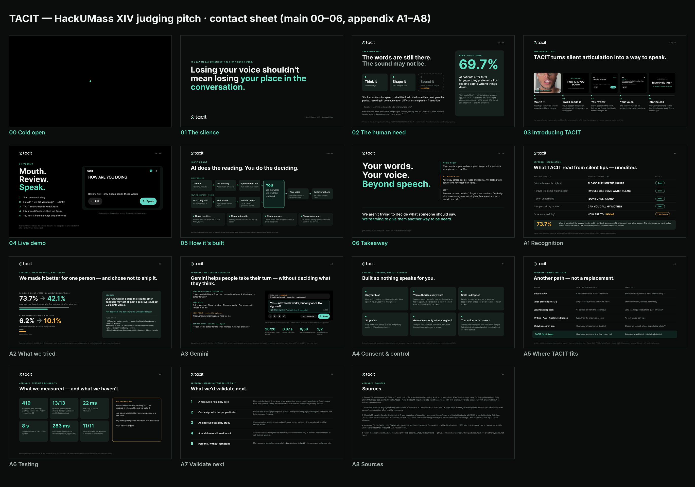

# TACIT — the weekend at a glance

TACIT was built solo at **HackUMass XIV** (14–15 November 2026), with AI coding agents as the engineering team. This
folder collects everything around the code: the pitch, the demo film and the Devpost submission. The numbers below
come from this repository's Git history and test suites.

**Links:** [Demo video (2:48)](https://youtu.be/GeV55H-ozqw) ·
[Devpost](https://devpost.com/software/tacit-7fygt5) ·
[Pitch deck (Figma Slides)](https://www.figma.com/slides/jf8CzZjdqJfhMHhcb9lCrT) ·
[Deck as PDF](pitch/TACIT_HackUMass_Judging_Pitch.pdf)

## By the numbers
| | |
|---|---|
| Build window | First commit Sat 14 Nov 03:21 ET → final demo build Sun 15 Nov 13:06 ET (~34 hours) |
| Commits on `main` | 195 atomic Conventional Commits, each pushed through CI |
| Code | ~14.3k lines TypeScript · ~9.0k Swift · ~5.5k Python · ~1.4k JavaScript |
| Automated tests | **450 on `main`**: server 204 (Vitest) · native app 116 (XCTest) · web 80 · recognition 50; CI on every push |
| Languages / runtimes | Swift (SwiftUI, AVFoundation, Vision, CoreAudio) · Node 22 / TypeScript · Python 3.12 / PyTorch · React |

## What got built
- **A native macOS app in the notch** (SwiftUI): live camera pipeline with on-device lip tracking (Apple Vision),
  review-first speech, Help Me Respond, My Voice, and a Living Mark animation that shows the app's state.
- **Visual-only speech recognition** (Python/PyTorch): Auto-AVSR wrapped as a local service, plus a frozen offline
  benchmark, dataset tooling and a personal-adaptation trainer (`recognition/`).
- **A safety-first speech server** (Node/TypeScript): authenticated WebSocket protocol, session authorization, stale
  result dropping, and Stop that cancels queued and playing audio (`server/`, `shared/protocol.ts`).
- **Audio routing into real calls** (Swift/CoreAudio): `tacit-route` plays speech into one selected virtual microphone
  (BlackHole) with a loopback check, so Google Meet or Zoom hears TACIT as a normal mic (`macos/TacitRoute/`).
- **Gemini integration**: Help Me Respond with structured JSON output, deterministic checks on every draft and a
  20-case eval (20/20 passed, p50 872 ms). Details in the main [README](../README.md).
- **Brand and film**: a custom identity rendered from one Swift geometry source (`docs/brand/`), and a demo film
  written as code in Remotion ([`film/`](film/README.md)).

## Research, measured honestly
The main experiments were pre-registered, and negative results are kept:
- [Personal adaptation v2](../docs/research/TACIT_PERSONAL_ADAPTATION_V2.md): pre-registered fine-tuning on the
  founder's own silent speech. Validation word errors fell from 84 to 36, but a regression guard failed, so the
  result is recorded as NO-GO and the demo shipped on the base model.
- [AirPods silent speech](../docs/research/AIRPODS_SILENT_SPEECH.md): a jaw-motion probe (`airpods/`) with held-out
  tests. NO-GO for word recognition. [Apple Watch feasibility](../docs/research/WATCH_FEASIBILITY.md): a literature
  review and a watchOS sensing probe (`watch/`), still inconclusive without on-device data.
- [Gemini deep integration](../docs/research/gemini/): an architecture exploration plus the Referent Bridge
  prototype (101 tests, real Gemini calls on a fixed budget, NO-GO on that evidence).
- [VSR alternatives](../docs/research/VSR_ALTERNATIVES.md), [landscape](../docs/research/landscape.md),
  [meeting-audio design](../docs/research/PRESENCE_MEETING_AUDIO.md), [My Voice](../docs/research/MY_VOICE.md).

## How the agents were coordinated
Several AI coding agents worked in one repository at the same time. [`AGENTS.md`](../AGENTS.md) sets file ownership,
a single Git writer, atomic-commit rules and safety rules every agent must follow. [`docs/HANDOFF.md`](../docs/HANDOFF.md)
is the shared log of state, checks and decisions, and [`docs/WORKSTREAM_SOL.md`](../docs/WORKSTREAM_SOL.md) holds
the frontend agent's checkpoints. Experimental work that wasn't promoted lives on its own branch
(`experiment/tacit-flow`).

## In this folder
| Path | What |
|---|---|
| [`pitch/`](pitch/README.md) | Judging deck (PDF, PPTX, slide renders), 90 s / 3 min / 5 min scripts, Gemini pitch, 20-question Q&A, evidence sheet, and the code that generated the deck |
| [`film/`](film/README.md) | Remotion source for the demo film, captions, render and mastering scripts, storyboards and production notes |
| [`devpost/`](devpost/) | Devpost gallery images, video thumbnail, social preview, submission notes, and the Remotion source used to render the gallery |
